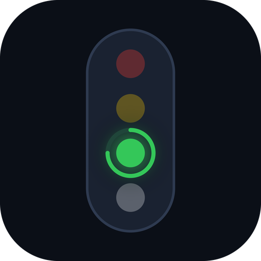

<p align="center">
  
</p>

<h1 align="center">Agent Lights</h1>

<p align="center">
  A live traffic light for your AI coding agents.<br>
  See at a glance whether Claude Code, OpenAI Codex or Google Antigravity is working, waiting for you, or out of usage.
</p>

<p align="center">
  <a href="../../releases/latest"><b>Download</b></a> ·
  <a href="https://agent-lights.web.app">Web demo</a>
</p>

## What it does

- **Four-colour traffic light per agent**: green = working, yellow = needs your input, red = out of usage, white = idle.
- **Usage rings** for the 5-hour and weekly limits, with reset countdowns. Rings turn red below 10 % remaining.
- **Notifications** when an agent hits a limit and when it is available again.
- **Two modes**: a tiny always-on-top HUD (toggle with **Alt + Space**, works from any app) and a large window (expand button).
- **Your own agents** (Kimi, Grok, anything): add them in Settings and report status with one HTTP call.

## Install

Open the [latest release](../../releases/latest) and pick your platform:

| Platform | File | How |
| --- | --- | --- |
| Windows | `AgentLights-windows-setup.exe` | Run the installer. (Portable: `AgentLights-windows-x64.zip`.) |
| macOS | `AgentLights-macos.zip` | Unzip, right-click the app, **Open** (unsigned build, first launch only). |
| Linux | `AgentLights-linux-x64.tar.gz` | Extract and run `agentlights`. |
| Android | Google Play internal test, or `AgentLights-android.apk` | Allow installs from your browser once. |
| Web | [agent-lights.web.app](https://agent-lights.web.app) | Demo mode only (see below). |

**Updates:** the desktop app checks GitHub Releases and tells you when a new version is out.

## Sign-in: you don't need one

There are no accounts. The desktop app reads what your agents already keep on your own machine:

- **Codex** and **Antigravity**: their local usage data.
- **Claude Code**: on first start the app adds a small, reversible wrapper around Claude Code's `statusLine` setting.
  Claude Code hands that command your real 5-hour and weekly usage; the wrapper stores it and still runs your previous status line unchanged.
  Your old setting is kept in `~/.claude/agent-lights-statusline.prev` and `settings.json.bak`.
  The numbers refresh whenever a Claude Code session is running; until then the last known values are shown.

Nothing is sent to any server. Tokens and logins never leave your computer.

**Phone and web:** these show the desktop's live status. In the mobile app open *Settings → Sync host* and enter your desktop's address
(the desktop must allow LAN access). A page served over `https://` cannot open the desktop's `ws://` socket, so the hosted web app runs in demo mode.

## Report status from your own agent

```bash
curl -X POST http://127.0.0.1:47832/api/hook \
  -H "Content-Type: application/json" \
  -d '{"agent":"kimi","event":"working","usage":{"5h":40}}'
```

Events: `working`, `permission`, `stop`, `error`. Add the agent under *Settings → Eigene Agenten* first.

## Build from source

```bash
flutter pub get && flutter analyze && flutter test
flutter build windows --release   # or linux / macos / web / apk
```

Releases are built by GitHub Actions ([release.yml](.github/workflows/release.yml)) whenever a `v*` tag is pushed:
all platforms, a GitHub Release, the Android internal test track and (optionally) Firebase Hosting.
Signing keys and deploy credentials exist only as GitHub Actions secrets, see [docs/PLAY_STORE_SETUP.md](docs/PLAY_STORE_SETUP.md).

## License

[MIT](LICENSE)
